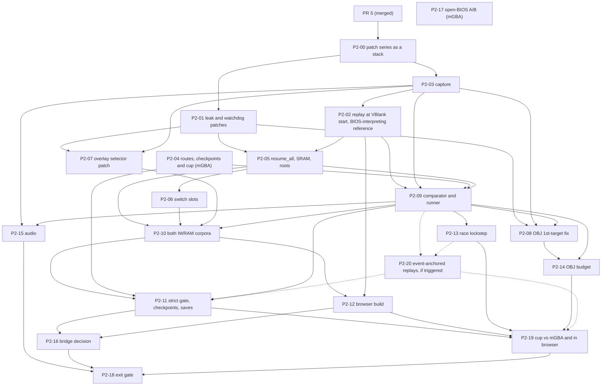

# Phase 2 implementation plan

**Date:** 2026-10-10
**Status:** Proposed, for owner review together with [ADR 0001](adr/0001-port-via-static-recompilation.md).
**Inputs:** [phase2-diagnosis.md](research/phase2-diagnosis.md) (cited as "diagnosis §n"), [phase1-findings.md](research/phase1-findings.md), [open-bios.md](research/open-bios.md), [gbarecomp-integration.md](research/gbarecomp-integration.md), PR #5 (merged as `a7efc60`; [toolchain.md](toolchain.md)).

Phase 2 in [plan.md](plan.md) builds the native recompiled game and proves it against mGBA. This document breaks that into small tasks, each meant to be one pull request, in a dependency order that lets several agents work at once.

## Goal and exit criteria

Phase 2 is done when all of the following hold, on the owner's machine, with the ROM and retail BIOS pinned in ADR 0001:

1. **Native, coverage.** On every route in the route manifest, including the full cup, the native build runs under `GBARECOMP_STRICT_STATIC=1` with `self_heal_coverage=FULLY_STATIC dispatch_misses=0 interpreted_insns=0 healed_native=0`, `unmapped=0 io_unhandled=0`, exit code 0, and stops exactly at `--frames`.
2. **Native, recompilation correctness.** On every route, the recompiled build and gbarecomp's interpreter (`GBARECOMP_FORCE_INTERP=1`, with the BIOS interpreted too, P2-02) give identical framebuffer CRCs and RAM region hashes, captured at VBlank start, on every frame (ADR 0001, comparison 1). RAM-hash equality between the backends has not been measured yet (**unverified**); P2-09 measures it first. If some state legitimately differs between backends, this criterion uses the excluded-region list that P2-09 documents, each region with its cause.
3. **Native, fidelity against mGBA.** On the full cup, the two-layer comparison with mGBA and the game-state RAM hashes pass on every frame except allowlisted differences, each with a written cause. Race results (finishing position and time per race) equal mGBA's, and any save the route writes is byte-identical to mGBA's (ADR 0001, comparison 2). P2-19 produces this evidence.
4. **Web.** The browser bundle, built with our own main and both IWRAM corpora, runs `boot_to_race`, `full_race_cross` and the cup route in headless Chromium (audio muted) from a frame-indexed replay: 0 dispatch misses, no abort, and sampled framebuffer CRCs equal to the native run. P2-12 covers the first two routes, P2-19 the cup.
5. **Saves work.** The options-save route writes a 32 KiB `.sav` byte-identical to mGBA's, and a boot from it loads it (the language menu is skipped).

A gbarecomp run counts toward criteria 1, 2 and 4 only if it follows its route: every checkpoint of the route manifest holds on the gbarecomp side (P2-04, P2-09). Without that check, a replay that drifts onto another screen could pass all three: the coverage banner says nothing about which screen the game is on, comparison 1 drifts the same way on both backends, and the browser run is compared with the native one.

Criterion 3 carries the main risk: races currently leave lockstep with mGBA in every gbarecomp backend (diagnosis §6). Task P2-13 investigates it first. If the cause is an emulation-timing difference that neither engine is known to get right, the owner decides whether to revise criterion 3 (ADR 0001, "Open risk").

## Ground rules for every task

- One task, one branch, one pull request. English only. Never commit the ROM, the BIOS, saves, screenshots or frame dumps of the game, generated code, heal caches, or raw captures. Commit scripts and configs that regenerate them.
- Every new `game.toml` entry is reviewed by a human and carries a `note` with its evidence: ROM SHA-1, address, and how it was found.
- Claims in PR descriptions and docs carry evidence (command, frame, address, `file:line` at the gbarecomp pin). Mark anything unconfirmed **unverified**.
- gbarecomp changes go in `patches/gbarecomp/` with a README row, never into the submodule. Each patch header says what it fixes and how it was tested, ready for upstream. Nothing is filed upstream without the owner.
- Tests that need the ROM run locally only. CI runs what needs no game data: gbarecomp's tests, the patch-tooling test (P2-00), the synthetic repro ROMs if they can run there, and the comparator's unit tests.
- Native test runs are headless with `SDL_AUDIODRIVER=dummy`, `GBARECOMP_SELFHEAL_RECOMPILE=0`, a fresh save, and RAM healing off. Browser runs use headless Chromium with audio muted.
- Store CRCs, hashes and diff summaries, not frames (raw frames are 115,200 bytes each, and the disk filled up during the diagnosis).
- Compare backends, or gbarecomp with mGBA, only through captures taken at VBlank start, never through `--dump-png`: where a `--frames N` run stops depends on the backend and the game state, so the dumped frame can be N or N+1 (diagnosis §7.3). A match on a static screen is not evidence (diagnosis §7.4).

### Commands used below

The native executable is built by `scripts/build-native.sh` (PR #5) into `build/native/MotoRacerAdvanceRecomp`. "Native run, N frames" means, from `build/native`:

```sh
mkdir -p ../saves && rm -f ../saves/t.sav
SDL_AUDIODRIVER=dummy GBARECOMP_SELFHEAL_RECOMPILE=0 ./MotoRacerAdvanceRecomp \
  --bios ../../bios/gba_bios.bin --rom ../../roms/moto-racer-advance.gba \
  --frames N --no-window --save-path ../saves/t.sav ../../game.toml
```

Variables a task adds are exported first, as in `(cd build/native && export VAR=value && <native run, N frames>)`. Written as `VAR=value <native run>`, they would apply only to the `mkdir`. P2-09's `scripts/replay-test.sh` wraps all of this.

The mGBA reference is `tools/analysis/harness/run_harness.sh --out <dir> --script tools/analysis/input/<route>.txt [--frames N] [--trace A-B] [--shot-every N]` ([tools/analysis/README.md](../tools/analysis/README.md)).

Scripts and files marked *(new)* do not exist yet; the task that introduces them may rename them.

## Starting point

- **PR #5** is merged (`a7efc60`). It added the gbarecomp submodule, `game.toml`, `scripts/`, `patches/gbarecomp/0001-0002` and [toolchain.md](toolchain.md). Its files there are identical to `b90e960`, the commit the diagnosis ran on (`git diff b90e960 a7efc60` changes only files that came from `main`), so the diagnosis's statements about "PR #5's config" hold for `main`.
- **Prototypes** from the diagnosis exist outside the repository: the overlay selector and front-end corpus, the two runtime patches, the PPU fix and budget, capture instrumentation, a replay converter, a headless Chromium driver, and synthetic repro ROM generators. Tasks port them; they are not committed as they are.

## Patch queue

Numbers are proposals and are assigned when each patch lands. The four investigations each proposed a "0003"; this table reconciles them.

| Proposed | Patch | Source | Size | Task | Upstream (diagnosis §9) |
|---|---|---|---|---|---|
| 0003 | IRQ call-return leak: pop at the IRQ-continuation heal, and truncate to the entry depth when `runtime_irq()` returns | runtime-bugs prototype; the web-abort prototype is its second half | 17 lines | P2-01 | U1 |
| 0004 | End-of-run quit waits for IRQ handlers (IRQ-depth guard) | runtime-bugs prototype, first half of its 0004 | 1 line plus comment | P2-01 | U2 |
| 0005 | Observation capture, env-gated: at VBlank start, the framebuffer CRC (optional raw dump), RAM region hashes, the cycle counter and the route-checkpoint fields; render-time per-scanline state; bytes written to FIFO A and B per frame; a file sink natively and a console sink for the browser | ppu-diffs and iwram-overlays diagnostic prototypes | about 200-300 lines | P2-03 | U15, U16 |
| 0006 | RAM overlay table selector, plus heal-tier skip for selected PCs | iwram-overlays prototype | about 40 lines plus additions | P2-07 | U5, U6 |
| 0007 | OBJ is a color-effect 1st target when BLDCNT bit 4 is set | ppu-diffs prototype | 17 lines added, 10 removed | P2-08 | U13 |
| 0008 | `GBARECOMP_WEB_MAIN` and `GBARECOMP_WEB_MAIN_FLAGS` overrides in `build_web.sh` | iwram-overlays prototype | 1 line | P2-12 | U8 |
| 0009 | Per-line OBJ cycle budget, switchable | ppu-diffs prototype | about 75 lines plus the wide compositor | P2-14 | U14 |
| (0010) | Bridge frame boundary (present, input, quit inside a bridge) | runtime-bugs and web-abort prototypes, two designs | 39-60 lines | P2-16, only if adopted | U3 |
| (extra) | Input replay at VBlank start | only if P2-02's game-owned approach fails | small | P2-02 | U10 |

Most of these touch `patches/gbarecomp/README.md`: merge them one at a time and rebase. Several will stack on nearby code (0007 and 0009 in the same compositor code, 0003 and 0006 in `runtime_arm.cpp`, 0010 next to 0004's quit check; their exact hunks are not known yet). PR #5's `scripts/apply-patches.sh` judges each patch on its own against the fully patched tree (reverse check, then forward check, otherwise it stops, l.47-56), and every build calls it through `ensure_patches` (`scripts/lib/common.sh:230-232`). With two stacked patches whose hunks are within each other's context, the earlier one neither reverse-applies nor applies on the full tree, so every build would stop (reproduced on a toy repository: patch A edits line 10, patch B line 12). P2-00 makes the tooling apply the series as a stack before any new patch lands.

## Tasks

Effort figures are rough guesses for one agent, in working days. "Depends on" lists what a task's acceptance or test commands need; the code of a task can often be written earlier and merged once its dependencies have landed.

### P2-00. Apply the gbarecomp patch series as a stack

*Depends on:* PR #5 (merged). *Effort:* 0.5. It lands before any new engine patch.

Scope:

- `scripts/apply-patches.sh` applies `patches/gbarecomp/*.patch` in name order on top of the pin, instead of judging each patch on its own against the fully patched tree (see "Patch queue"). When the submodule's tracked files are not exactly "pin plus the current series", it restores them to the pin, including files an earlier series added, and applies the series in order.
- A stamp under `build/` records the pin, a hash of the series and the resulting tree state. `ensure_patches` does nothing when the stamp matches. `--check` reports whether the tree is "pin plus series". `--reverse` restores the pin.
- If the submodule has changes that no known series explains (a hand edit), the script stops without touching anything and says so.
- A/B builds: a way to leave named patches out (for example `--without 0003`), building into a separate directory so the normal build is never left stale. The next normal build restores the full series. P2-01's "fails without 0003" uses it.
- Update `patches/gbarecomp/README.md` and `docs/toolchain.md`.

Acceptance:

- A shell test that needs no game data (so CI can run it): on a toy repository with two stacked patches (A edits line 10, B line 12), the new script applies, re-applies with no change, checks, reverses, and builds with B left out. PR #5's script fails on the same case.
- PR #5's 0001 and 0002 still apply; `scripts/build-native.sh` and `scripts/test-engine.sh` pass.
- A hand edit inside the submodule stops the script with a message, and the edit is not lost.

Tests:

```sh
tests/tooling/apply-patches-test.sh                      # (new)
scripts/apply-patches.sh --check && scripts/build-native.sh && scripts/test-engine.sh
```

### P2-01. Fix the IRQ call-return leak and the end-of-run watchdog

*Depends on:* P2-00. *Effort:* 0.5-1.

Scope:

- Add patches 0003 and 0004 from the queue.
- Add the two synthetic repro ROM generators (Python, no Nintendo data, header logo left zero) under `tests/repro/` *(new)* with their configs (diagnosis §1.1), and `scripts/repro-test.sh` *(new)*, which generates, recompiles, builds and runs them.
- Correct `docs/toolchain.md` as listed in diagnosis §8.

Acceptance:

- `scripts/apply-patches.sh --check` reports the series applied, and `scripts/test-engine.sh` passes (52 of 52 with the test ROMs).
- Both repro ROMs fail on the pin without 0003 (built with P2-00's way of leaving a patch out; `generated call-return stack overflow`, exit 134) and pass with it.
- With the PR #5 config plus these patches, native runs of 3,600, 5,400 and 12,000 frames exit 0 with no `SELF-HEAL bridge ... exceeded` message and no `did not iret` watchdog. On this config a run may still stop a few frames past `--frames` while a long bridge runs (the intro player is interpreted); exact stops are required from P2-10 on.
- No frame-identity check against the unpatched build: it cannot show that guest behavior is unchanged, because the unpatched build runs inside the stale bridge from VBlank 1029 on and the title frames it still produces are static (diagnosis §1.1, §7.4). The check that can show it is comparison 1 against the interpreter over busy frames, through VBlank-start captures; P2-05 runs it on the first build that reaches the race.
- If the repro ROMs run in CI without a BIOS dump (**unverified**: gbarecomp may need a 16 KiB BIOS image even with `--bios-skip-intro`), CI runs them. Otherwise the PR says so and they stay local.

Tests:

```sh
scripts/setup.sh && scripts/apply-patches.sh --check && scripts/test-engine.sh
scripts/repro-test.sh                                    # (new)
scripts/build-native.sh && (cd build/native && <native run, 3600 frames>)
```

### P2-02. Replay inputs: one converter, applied at VBlank start

*Depends on:* P2-03, whose VBlank-start captures the acceptance uses (the converter and callback can be written in parallel with it). *Effort:* 1.

Scope:

- `tools/replay/script2replay.py` *(new)*: harness input script to a replay file, with the frame convention documented in the script and in `tools/analysis/README.md`. Port and merge the two prototype converters; their offset conventions differ (diagnosis §7.3). The file keeps gbarecomp's `frame,0xKEYS` lines but starts with its own header line, `mra-keyinput-v1` (harness-numbered frames, applied at VBlank start), not a `#` comment: gbarecomp's loader skips only lines that start with `#` and rejects any other line it cannot parse (`runtime.cpp:3267-3279`), so a file in our convention cannot be fed to `GBARECOMP_INPUT_REPLAY`, which applies events on a different frame, by mistake.
- Apply replays at VBlank start from game-owned code, without an engine patch: our `src/main.cpp` installs `RunOptions::input_frame`, which gbarecomp calls "once per emulated frame at VBlank start — before the VBlank IRQ is raised" and whose returned keys are ANDed with the host keys (`gbarecomp/src/runtime/runtime.h:144-155`; installed at `runtime.cpp:2424-2431`). It reads its own trace, named by an environment variable of ours, because gbarecomp suspends `input_frame` while `GBARECOMP_INPUT_REPLAY` is set (`runtime.cpp:2357-2358`).
  - Install `input_frame` only when that variable is set. A non-null `input_frame` is gbarecomp's touch-policy hook: it switches every run to touch-policy mode (`runtime.cpp:2424-2431`; windowed builds, `configure_touch(opts.input_frame != nullptr, …)` at `runtime.cpp:2898`; the browser's `TouchModePolicy`, `host_window_web.cpp:412-416`), which would change the player builds.
  - Where it runs: gbarecomp installs it in every mode, with no web guard (`runtime.cpp:2424-2431`), and calls it from the device tick at VBlank start (`runtime_bus_bridge.cpp:597-602`), which the interpreter bridge also drives (`runtime_arm_default_aborts.cpp:599`). So it should keep supplying input inside bridges (P2-05 checks it). That it works in the browser is **unverified**; if it does not, write the engine patch instead (U10).
- **The BIOS-interpreting reference for comparison 1** (ADR 0001 decision 5), also in `src/main.cpp`. On its own, `GBARECOMP_FORCE_INTERP=1` sends every SWI to the recompiled BIOS, so the six BIOS SWIs would run the same generated code on both sides of comparison 1 (diagnosis §7.1). When `GBARECOMP_FORCE_INTERP` is set and a variable of ours asks for it (for example `MRA_INTERP_BIOS=1`), our main installs `g_runtime_force_interp_hook` returning 1 for PCs below `0x4000`. `dispatch_resolve` consults it before the BIOS table (`runtime_arm.cpp:874-880`), so this needs no engine patch. The reference's banner then reads `NOT_STATIC dispatch_misses=1` (each BIOS entry is a bridge), so no gate reads that banner.
- **How the browser gets a trace.** The web bootstrap honors `?env=` and `?args=` only in a bundle built with `--dev` and served from localhost (`packaging/web/bootstrap.js:10-16` at the pin), and its `preRun` writes only `/data/game.gba`, `/data/gba_bios.bin` and `/data/runtime.toml` into the wasm file system (`bootstrap.js:66`). A trace file cannot reach the bundle without one more gbarecomp patch. Instead, the converter also writes a C++ source holding the route traces, under `build/` (it is generated), and it is compiled only into test builds; the same environment variable, passed through `?env=`, names an embedded route. The iwram-overlays prototype did this (`traces.h`). A bundle with embedded traces is a test bundle: built with `--dev`, kept under `build/`, never published (P2-12).
  - Natively the trace source is a CMake option of the root `CMakeLists.txt`, off by default. In the browser, `build_web.sh` configures the game library with no `-D` options of ours (`emcmake cmake -S "$PROJECT" -B "$GAME_BUILD" -DCMAKE_BUILD_TYPE=Release -DCMAKE_CXX_FLAGS=-pthread`, `build_web.sh:206-207`), so `scripts/build-web.sh` passes the trace source to `web/game-lib/CMakeLists.txt` in an environment variable, as it already does for `MRA_GAME_GENERATED_DIR`. Builds without traces link an empty table.
- The callback only steers input; it does not hash RAM. The public read, `bus_read_u32` (`runtime_arm.h:111`), updates bus state on every call (`sync_bios_access()` and `note_pc`, `runtime_bus_bridge.cpp:256-263`, `:445-456`; the open-bus state the game reads, Phase 1 §6), so RAM hashes come from patch 0005 (P2-03).

Acceptance:

- On `boot_to_race`, gbarecomp's interpreter (`GBARECOMP_FORCE_INTERP=1`) reaches the race. Its VBlank-start captures (P2-03) are compared with mGBA's by joining the two capture files on the frame column and comparing the CRC columns (the comparator comes with P2-09): frame CRCs are equal on every front-end frame except the known fade and timing frames (diagnosis §5), which are listed. No `--dump-png` comparison across engines (diagnosis §7.3).
- A wrong offset must be detectable: the diagnosis measured 818 exact frames in 2400-4005 at the best offset and 226 at the next one, so report both counts for the chosen convention and its neighbors.
- The check that inputs keep being applied during a long interpreter bridge moves to P2-05, the first build that reaches the race with its loop bridged.
- Without our variable, `input_frame` stays null (no `touch_policy=ENABLED` line in the log).
- The BIOS-interpreting reference runs no generated loop: with `GBARECOMP_ABORT_AFTER_BRANCHES=0`, which aborts at the first loop branch taken in generated code (`arm_codegen.cpp:465-470` in arm-recomp-core), a 600-frame boot does not abort with the hook and aborts at the game's first SWI without it (the diagnosis measured both, §7.1).

Tests:

```sh
mkdir -p build/replays
python3 -I tools/replay/script2replay.py tools/analysis/input/boot_to_race.txt > build/replays/boot_to_race.csv
(cd build/native && export GBARECOMP_FORCE_INTERP=1 MRA_REPLAY=../replays/boot_to_race.csv <capture env> && <native run, 4400 frames>)
(cd build/native && export GBARECOMP_FORCE_INTERP=1 MRA_INTERP_BIOS=1 GBARECOMP_ABORT_AFTER_BRANCHES=0 && <native run, 600 frames>)
```

As implemented: `MRA_REPLAY=FILE` or `MRA_REPLAY=embedded:ROUTE`, and `MRA_INTERP_BIOS=1` ([tools/replay/README.md](../tools/replay/README.md)). Results: [phase2-replay.md](research/phase2-replay.md).

### P2-03. Capture the same observations from both engines

*Depends on:* P2-00. *Effort:* 1.5-2.5.

Scope:

- **Sample point.** At VBlank start gbarecomp latches the framebuffer, runs the VBlank-timed DMA, calls the input hook and then raises the VBlank IRQ (`runtime_bus_bridge.cpp:597-604`). The per-frame record is taken after the latch and before the VBlank-timed DMA (`run_timed_dma(1)`), the input hook and the IRQ, which is where the harness samples: mGBA schedules its VBlank-timed DMA 3 cycles and the IRQ 7 cycles after the VBlank-start event at which `runFrame` returns ([phase2-capture.md](research/phase2-capture.md) §1; owner decision 1 in PR #12). DMA3 runs during VBlank in races (diagnosis §5.5), so RAM hashes taken on opposite sides of it would differ without any bug; on race frame 4000 both engines' records come before it, since the CPU starts it at VCOUNT 174 and 196. On `full_race_cross`, frames 1-25,000, the game enables no VBlank-timed DMA; the other routes were not scanned (**unverified** there), which does not matter for comparisons, since both engines sample before that DMA.
- **gbarecomp side:** patch 0005, env-gated and observation-only.
  - At that sample point, named by harness frame (`frame_count` + 1, diagnosis §7.3): the framebuffer CRC, an optional raw dump for a frame range, RAM region hashes, the cycle counter (for P2-13) and the runtime's interpreted-instruction count, plus the route-checkpoint fields (DISPCNT, the IWRAM word at `0x03000000`, which tells the resident image, and a configurable list of RAM bytes that the route manifest names, P2-04). The hashes read the bus's backing arrays (`GbaBus::ewram_ptr()`, `iwram_ptr()`, `src/gba/gba_bus.h:181-182`), never `bus_read_*`, which has side effects (P2-02). Patch 0005 adds its own call at that site; it does not use `runtime_set_vblank_input_hook`, which `input_frame` already occupies (`runtime.cpp:2427`).
  - Per line, the render-time state: video registers, palette[0], and CRCs of OAM, palette and VRAM, sampled before each line is rendered (diagnosis §7.2).
  - Per frame, the bytes written to FIFO A and FIFO B by the CPU and by DMA, for P2-15. The existing `GBARECOMP_AUDIO_FIFO_TRACE` cannot serve: it is a 1,024-entry ring of samples consumed at timer overflow (`gba_audio.h:138-142`, `gba_audio.cpp:567-580`), readable only through the TCP debug server (`src/debug/tcp_debug_server.cpp:376-380`). `GBARECOMP_MMIO_DUMP`'s ring wraps after about 2,500 frames of this game (diagnosis U16).
  - Two sinks: a file natively, and standard output for the browser, one prefixed line per per-frame record. In the browser, standard output reaches the console (`print` in `bootstrap.js:65`), where P2-12's driver reads it; `line()` there truncates text to 2,000 characters (`bootstrap.js:5`), so a record must stay shorter. Full line records and raw frames stay native-only.
- **mGBA side:** in `tools/analysis/harness`, the same observations: per-line state sampled where mGBA renders the line (port the ppu-diffs harness prototype), and per-frame framebuffer CRCs, RAM region hashes, cycle counts, checkpoint fields and FIFO writes at the sample point above.
- **Common format:** one TSV schema on both sides, with harness-numbered frames.
  - The frame CRC is computed over RGB555 on both engines: each channel reduced to 5 bits before hashing, so the two pixel formats cannot make every frame differ.
  - The schema includes the mask table, applied at capture time on both sides: unused register bits (BLDALPHA `0x1F1F`, BLDY `0x1F`; diagnosis §7.2), and the RAM regions as named address ranges, each hashed on its own, with sub-ranges that can be masked out (for example the IRQ stack slot `0x03007F9C`, ADR 0001 comparison 2). P2-09 adds masks only by changing this table, with a cause for each.
  - To bound storage, the default per-frame record holds one CRC over that frame's masked, serialized line records, and FIFO writes as a count and a CRC. Full line records and FIFO bytes are written only for a requested frame range. A comparison finds failing frames from the CRCs and re-runs that range with full records; runs are deterministic (diagnosis §7.6).

Acceptance:

- **Capture off.** With the capture variables unset, the patched build behaves exactly like the unpatched one: the same final line (`final_pc`, `steps`, `ppu_vcount`, `ppu_frames`) and byte-identical `--dump-png` at frames where the screen changes: 240 (BIOS fade), 300 and 320 (license fade), 600 and 1000 (intro), with no input. Both sides of each comparison use the same backend; run it once on the interpreter (`GBARECOMP_FORCE_INTERP=1`) and once on the recompiled build. Title frames do not count (diagnosis §7.4).
- **Capture on.** With capture enabled, the same final lines and dumps as with capture off, and two capture runs give byte-identical capture files.
- Both engines produce captures for frames 1-3,000 of a boot without input (the interpreter on the gbarecomp side), with harness-numbered frames.
- On frames 1-330, the per-line state of the two engines differs only where the diagnosis explains it (§5.4, §7.2). The comparator comes with P2-09; here it is a join of the two capture files on the frame column, comparing the line-state CRCs, then a diff of the full line records of the frames that differ.
- The sample point is documented for both engines, with the race frame that checks it.
- The console sink prints the same per-frame records as the file sink, each under 2,000 characters.
- Size: without full line records, a 25,000-frame capture stays under about 50 MB. Full line records cost about 40 KB per frame (about 1 GB for a 25,000-frame race), so they are written only for requested ranges.

Tests:

```sh
tools/analysis/harness/build.sh
tools/analysis/harness/run_harness.sh --out runs/boot3000 --frames 3000 <new capture options>
(cd build/native && export GBARECOMP_FORCE_INTERP=1 <capture env> && <native run, 3000 frames>)
```

### P2-04. Routes, including a full cup (mGBA only)

*Depends on:* nothing (mGBA harness only). *Effort:* 1-3 (high variance: the cup).

Scope:

- A route manifest `tools/difftest/routes.toml` *(new)* listing each route's input script, frame count, starting save and checkpoints. Start with the existing scripts: `boot_to_race`, `full_race_cross`, `race_gp`, `race_traffic`, `abort_race`, `options_save`, `multiplayer_lobby` (lobby only, no partner).
- **Every route starts from boot**, with an optional starting save, never from a savestate: gbarecomp cannot load an mGBA savestate. `abort_race` starts from one today (`--load-state RUN/mid_race.state`, `abort_race.txt:2-3`); rewrite it as `boot_to_race`'s inputs followed by its pause-and-abort inputs.
- **Checkpoints are game-state events that both engines' captures can show** (P2-03's checkpoint fields), so that P2-09 and P2-11 can check that a gbarecomp run follows the route. Each is a predicate on per-frame fields: DISPCNT (for example `0x1741` while a race is displayed, Phase 1 §2), the resident IWRAM image (the word at `0x03000000`: `0xE92D4FF3` for the front end, `0xE3A00640` for the race program, diagnosis §3.1), or a RAM byte once one is identified (a race index or a results field; where the game keeps them is **unverified**, and P2-19 needs the results anyway). For each event the manifest records mGBA's frame and the frame of the first later input that relies on it; a gbarecomp run follows the route when every event occurs, in order, before that input. In the harness, the same fields come from `trace.tsv` (DISPCNT, and `--trace-mem 0x03000000:4`).
- New scripts: restart from the pause menu; race, front end, second race (exercises both image switches twice); the cup.
- Inputs after a race are timed on mGBA's frames, but gbarecomp ends races at a different frame (diagnosis §6). Place them with slack: the first input after a race comes well after mGBA's race display ends, on screens that wait for input, so a run that ends the race somewhat earlier or later still lands them on the same screen. How much slack is enough is not known until gbarecomp runs the route (P2-09); a route that still does not follow needs P2-20.
- The cup: first check which Solo modes are open on a fresh save ([game-facts.md](research/game-facts.md) question 16; sources conflict). If Championship is locked, the owner chooses between reaching it by play in the harness (long, but from a fresh save) and starting from a save generated by a committed script (saves themselves are never committed). Open-loop inputs that hold A finish a race in 8th place (`full_race_cross`); whether that is enough to complete a cup is **unverified**.
- A route with a starting save copies it to a scratch file before each run and passes the copy: the harness's `--save` loads the file and writes the run's save back to it (`gbaharness --help`: "cartridge save file to load/persist"), so the original would change.

Acceptance:

- Every route is deterministic in the harness: two runs, each from a fresh copy of its starting save, give identical `trace.tsv`.
- Every route's checkpoints hold on its own mGBA run.
- Expected results (frames of key screens, finishing positions, whether SRAM is written) are recorded in `tools/analysis/README.md`, as for the existing scripts.

Tests:

```sh
for r in <routes>; do for k in a b; do \
  <copy the route's starting save, if any, to runs/$r-$k.sav and add --save runs/$r-$k.sav>; \
  tools/analysis/harness/run_harness.sh --out runs/$r-$k --script tools/analysis/input/$r.txt --trace 0-<end> --trace-mem 0x03000000:4; done; \
  cmp analysis-out/runs/$r-a/trace.tsv analysis-out/runs/$r-b/trace.tsv; done
```

### P2-05. Resume entries, SRAM routines and hidden ROM roots

*Depends on:* P2-01, because `static_resume_all` without the leak fix makes leaks more frequent (diagnosis §2.1); P2-02 for the replay (and P2-03's captures through it). *Effort:* 1.

Scope:

- `static_resume_all = true`.
- `[[code_copy]]` for the two EWRAM SRAM routines (`0x0203D7D4` from `0x0801192C`, size `0x34`; `0x0203D734` from `0x08011994`, size `0x3C`) with their Thumb roots (Phase 1 §1).
- The ROM roots hidden behind interpreted IRQ code: `0x0800255C`, `0x08002580`, `0x080025B0` and `0x08004168` (diagnosis §2.3).
- Review the 47 ROM seeds the overlay prototype took from miss reports. Keep only those with evidence; the rest wait for P2-11's miss reports.

Acceptance:

- `scripts/regen.sh` succeeds, and its log shows the new function count.
- On the IWRAM-interpreted build, `boot_to_race` up to frame 3290 and a 12,000-frame boot with no input report no ROM dispatch misses other than the switch slots P2-06 handles (IWRAM misses remain), with no abort or watchdog.
- **Comparison 1, first measurement** (also P2-01's frame-regression check): over `boot_to_race` frames 1-3,290, this build's VBlank-start frame CRCs equal those of the BIOS-interpreting reference (P2-02) on every frame. RAM-hash differences, if any, are recorded with the regions involved and handed to P2-09, which classifies them before comparison 1 gates. The comparator comes with P2-09; a join of the two capture files on the frame column is enough here. Equality is expected but **unverified**.
  - One known cause of difference on this build: IWRAM code still runs in interpreter bridges, and the bridge does not model HALT (diagnosis §1.5), while the reference's run loop does (`runtime.cpp:2149-2158`). A difference on a frame where a bridge was running (interpreted instructions in P2-03's per-frame record) and ran the BIOS IntrWait loop (the HALTCNT write storm of §1.5: P2-03's per-frame `halt_writes`; `GBARECOMP_MMIO_DUMP`'s default ring holds only about 8 frames of it, [phase2-capture.md](research/phase2-capture.md) §5) is recorded with that cause and does not fail this task; it must be gone on P2-10's static build, where no bridge runs. A difference on any other frame fails the task.
- Inputs keep being applied during a long interpreter bridge (moved from P2-02): on this build the race loop is bridged (diagnosis §3.4), and with P2-02's replay the bike moves. The VBlank-start frame CRCs at 3830, 4000 and 4400 differ from each other; with the stock replay those three frames were identical because the bike stayed at 0 km/h (diagnosis §1.4).
- The race still cannot complete on this build: natively the bridged race loop reaches the 200M-instruction cap around frame 5,100 (diagnosis §3.4). That is expected until P2-10.

Tests: `scripts/build-native.sh`, then native runs of 3,290 and 4,400 frames with the `boot_to_race` replay and capture, the same 3,290 frames on the BIOS-interpreting reference (`GBARECOMP_FORCE_INTERP=1` and P2-02's variable), and 12,000 frames without input; read the coverage banner and `recomp_master_misses_A9MP.toml.frag`.

### P2-06. armcc switch-table case slots

*Depends on:* P2-05: its checks reuse P2-05's runs, and both edit `game.toml`. The script can be written earlier. *Effort:* 1.

Scope:

- `tools/seeds/find_switch_tables.py` *(new)*: scan for `cmp rM,#N; addls pc,pc,rM,lsl #2` dispatchers, size each from its `cmp`, check that every slot is a `b`, and print candidate `[[extra_func]]` entries with notes.
- Add the 239 reviewed slots of the 16 ROM-code tables (diagnosis §2.2). The 4 tables in the race image wait for P2-10.

Acceptance:

- Discovery grows by about 469 functions (2,259 to 2,728 on PR #5's config; the absolute numbers move with P2-05).
- The misses at `0x08011B98`, `0x08011BB8`, `0x08011BD4`, `0x08012460`, `0x08012480`, `0x08011DDC` and `0x08011DE8` are gone.
- Frames and coverage are otherwise unchanged: P2-05's VBlank-start captures over `boot_to_race` 1-3,290 are identical with and without the new seeds.
- The script finds 20 dispatchers in total, matching Phase 1's count of `addls pc` switches.

Tests: `python3 -I tools/seeds/find_switch_tables.py roms/moto-racer-advance.gba`, `scripts/regen.sh`, native boot runs as in P2-05.

### P2-07. RAM overlay selector patch

*Depends on:* P2-01 (`scripts/repro-test.sh`; P2-00's tooling through it) and P2-03 (captures for the "unchanged when unset" check). *Effort:* 1.

Scope:

- Port patch 0006 from the prototype (`g_runtime_ram_overlay_select` in `runtime_arm.h/.cpp`, reset in `runtime.cpp`).
- Add: skip the heal tier in `runtime_dispatch_miss` for PCs the selector claimed (diagnosis §3.2, limits); save and restore the selector with the multiplayer `RuntimeArmContext` (`runtime_arm.cpp:1603-1635`), or document clearly that link play is unsupported with it.
- A synthetic overlay repro ROM *(new, no Nintendo data)*: two different ARM routines copied to the same IWRAM address at different times, each writing a distinct result to EWRAM, compiled as a main corpus plus an `--output-prefix` corpus. This is also U5's upstream repro.
- The patch header says what the selector checks (the entry word only) and why upstream may prefer its own mechanisms (ADR 0001 decision 2, "Upstream fit").

Acceptance:

- gbarecomp's tests pass.
- The repro passes under `GBARECOMP_STRICT_STATIC=1` with a selector, and shows the wrong result without one (the bug the patch fixes).
- With the selector unset, behavior is unchanged: gbarecomp's tests, and VBlank-start captures over a 3,000-frame boot without input identical with and without the patch (same backend on both sides).

Tests: `scripts/test-engine.sh`, `scripts/repro-test.sh`.

### P2-08. OBJ 1st-target fix

*Depends on:* P2-01 (on PR #5's config a run of 2,716 frames or more aborts without it, diagnosis §1.3), P2-03 (per-frame captures) and P2-09 (its runner checks the result against mGBA). The patch can be written earlier. *Effort:* 0.5.

Scope: patch 0007 (diagnosis §5.1) in both compositors and the wide margin path, with the semi-transparency flag, plus a synthetic PPU test: mode 0, one normal OBJ, BLDCNT=`0x0090`, BLDY=16, expect white. P2-02 found the same bug on the game's own fades of `boot_to_race`, frames 2453-2481 and 3258-3289 (BLDCNT `0x00FF`; [phase2-replay.md](research/phase2-replay.md) §3), so the patch should change those frames too.

Acceptance:

- At frame 240, the VBlank-start raw frame goes from 3,622 pixels differing from the harness's frame 240 to about 300, all within one step.
- Against mGBA, P2-09's runner passes frames 220-269 of `boot_to_race` at layer 2 with the patch, and fails them without it (a build with P2-00's `--without 0007`).
- Over boot frames 1-2,717, per-frame CRCs with and without the patch differ only on frames 220-269.
- HLE and LLE stay byte-identical: per-frame CRCs of `build/native/MotoRacerAdvanceRecomp` and `build/native-lle/MotoRacerAdvanceRecomp` (from `scripts/build-native.sh --lle`) are equal on every frame.

Tests: `scripts/build-native.sh` and `scripts/build-native.sh --lle`, capture runs of 2,717 frames without input on both binaries, `scripts/replay-test.sh boot_to_race --against mgba` with and without the patch.

### P2-09. Comparator and replay test runner

*Depends on:* P2-02, P2-03, P2-04 (the routes' checkpoints) and P2-05: its RAM-hash classification uses P2-05's measurement, and its `--against interp` runs need a recompiled build that reaches the race (P2-01 comes through P2-05). *Effort:* 2-2.5.

Scope:

- `tools/difftest/compare.py` *(new; stdlib Python, run with `python3 -I`)*: both comparisons of ADR 0001 decision 5, on VBlank-start captures only (never `--dump-png`, diagnosis §7.3).
  - Comparison 1: exact frame CRCs and RAM hashes, minus any excluded regions this task documents (below). Its reference is P2-02's BIOS-interpreting interpreter run (`GBARECOMP_FORCE_INTERP=1` plus our variable). The plain interpreter, whose SWIs run the recompiled BIOS (diagnosis §7.1), stays available to split a failure between the BIOS translation and cartridge code.
  - Comparison 2, layer 1: exact per-line state, with P2-03's mask table.
  - Comparison 2, layer 2: exact pixels (RGB555) on lines with no effect, ±1 step per channel on effect lines, from raw frames captured only for the frames that fail layer 1 or a CRC check.
  - Comparison 2, RAM: per-frame hashes of the game-state RAM regions of P2-03's table against mGBA's, reported per region with its first differing frame and allowlisted like the layers (ADR 0001 decision 5).
  - It streams: it reads both captures frame by frame, keeps only counts and the first divergence (frame, line, column), and lists failing frame ranges, which the runner re-runs with full line records and raw frames (P2-03). Allowlist hits are counted per entry.
  - A frame map option for runs that are not in lockstep: a fixed offset per frame range, or a search over ±N frames that reports the best offset per frame (diagnosis §6 found -1 at 3350 and 3400). P2-13 and P2-14 use it; the exit gates use no map unless the owner accepts one (P2-13, P2-20).
- Per-route allowlists *(new)* with frame ranges, layer, cause and a diagnosis reference.
- `scripts/replay-test.sh <route> --against interp|mgba` *(new)* runs the harness and gbarecomp with the same replay, then the comparator. Until P2-10, the gbarecomp side of `--against mgba` is the interpreter (`GBARECOMP_FORCE_INTERP=1`): before that, the recompiled build cannot run a race with static IWRAM code (diagnosis §3.4).
- **Route following.** On every gbarecomp capture, the runner checks the route's checkpoints (P2-04): every event occurs, in order, before the first input that relies on it. A route that does not follow is reported as such, apart from comparison results. While comparison 1 holds, the recompiled build takes the same path as the interpreter, so the interpreter answers the question before P2-10.
- To localize a comparison 1 failure, the runner can re-run both sides with gbarecomp's fingerprint ring (`GBARECOMP_INSN_TRACE=1`, `GBARECOMP_FP_SAVE`; `runtime.cpp:2089-2094`) and diff the two files. The ring keeps about 8M instructions (`runtime_arm.cpp:382-388`), so the run must stop within about 60 frames after the divergence, and arming it costs about 640 MB of memory.
- Unit tests for the comparator on synthetic data (no game data), run in CI.

Acceptance:

- On `boot_to_race` frames 1-3290, against mGBA with gbarecomp's interpreter, the runner reproduces the diagnosis. Frames 220-269 fail layer 2 (the OBJ 1st-target bug, diagnosis §5.1; P2-08 then shows they pass with patch 0007). The timing-shaped frames of diagnosis §5.4 fail layer 1 and are allowlisted with that cause. Everything else passes.
  - P2-02's run of this route found more front-end frames that fail layer 2 ([phase2-replay.md](research/phase2-replay.md) §3): the same OBJ 1st-target bug on the game's fades, 2453-2481 and 3258-3289, and 2968-2973, which §5.4 lists as timing-shaped but whose line state is equal in both engines except on one line of 2972 (two OBJs overlap an affine BG there; cause **unverified**). This task classifies them.
- A deliberately wrong replay offset makes the run fail.
- The checkpoints of `boot_to_race` and `full_race_cross` hold on gbarecomp's interpreter. A replay with one menu input moved off its screen fails its checkpoint.
- **RAM-hash equality is measured before it gates.** Every RAM-hash difference between the recompiled build and the reference, from P2-05's measurement and from a 3,600-frame boot without input, is either fixed as a bug or explained. If some state legitimately differs between backends at VBlank start (gbarecomp's own cross-backend hash excludes such bookkeeping, `COSIM_ORACLE.md:123-131`; whether any of it lives in guest RAM is **unverified**), the fallback is a named list of excluded regions, each with its cause, or a different sampling point. The list is the one exit criterion 2 uses.
- Comparison 1 runs and reports, but gates only from P2-10 on.

Tests:

```sh
python3 -I -m unittest discover tools/difftest/tests      # (new)
scripts/replay-test.sh boot_to_race --against mgba
scripts/replay-test.sh boot_to_race --against interp
```

### P2-10. Compile both IWRAM images and select per dispatch

*Depends on:* P2-05, P2-06 (its script finds the race image's switch slots), P2-07, and P2-09: its tests use `scripts/replay-test.sh`, and it gates on comparison 1 and on P2-09's results (P2-02 and P2-03 through it). *Effort:* 2.

Scope (ADR 0001 decision 2):

- In `game.toml`: `[[code_copy]]` for the race image and the race IWRAM roots, each reviewed against Phase 1 evidence. Candidates: `0x03004844`, `0x030009A4`, `0x0300170C`, `0x03001CB0`, `0x03001BC4`, `0x03000000` and `0x030044D0` in ARM; `0x030044C0` and `0x030044C2` in Thumb. The mixer's three entries, from the ROM bytes (diagnosis §3.2): the ROM veneer at `0x0816280C` jumps to Thumb `0x030044C0`, whose `bx r0` goes to the Thumb code at `0x030044C2`, which enters ARM `0x030044D0` with `add r0,pc,#8; bx r0`. This settles the `0x030044C0`/`0x030044C2` mismatch in [phase1-findings.md](research/phase1-findings.md) §4: both are entries. The prototype seeded all three; keep a seed only where the finder does not reach the entry on its own, with a `note`.
- A front-end config *(new, for example `configs/frontend-iwram.toml`)* with the front-end image and its roots (`0x030004DC`, `0x030004DE` Thumb; `0x030004EC`, `0x03000708` ARM), plus `entry_pc = 0x03000000` and `static_resume_all = true`, as the prototype's front-end config had. Without resume entries, a guest return into front-end IWRAM code after an SWI unwind would be a dispatch miss, for the reason in diagnosis §2.1.
- `scripts/regen.sh` runs a second `gba_recompile --output-prefix fe_` pass into its own generated directory, and CMake builds both.
- `src/overlay_select.cpp` *(new)*:
  - the signature selector;
  - a startup check that none of the 525 overlapping words is equal between the two ROM sources;
  - an optional counter dump behind an environment variable;
  - a refusal to start when `GBARECOMP_RAM_OVERLAY_HEAL` is set.
- Check the game against the invariants that patch 0006's header lists, with the evidence in `docs/research/`. Among them: no direct branch (B or BL) into the overlap from code outside the resident image, such as EWRAM code or the race image's tail, since `gba_recompile` compiles a direct branch to a function of the same corpus as a call by name, which the selector never sees (**unverified** for the game).
- The switch slots of the 4 race-image tables (P2-06's script).

Acceptance (on the M4 Pro). The prototype measured these numbers with a diagnostic VBlank-start replay and the extra roots above (diagnosis §3.2). With P2-02's replay the counts may differ, so the gates are the zero counts; the other numbers are for information.

- `boot_to_race` 4,400 frames and `full_race_cross` 25,000 frames under `GBARECOMP_STRICT_STATIC=1`: `FULLY_STATIC`, 0 misses, 0 interpreted, `ppu_frames` equal to `--frames`.
- The selector never returns "no image" (the prototype made about 51 million calls in the full race, 0 of them without a match).
- Comparison 1 (against the BIOS-interpreting reference) is exact on every frame of both routes, apart from any excluded regions P2-09 documented. The frames P2-05 attributed to HALT inside bridges must match too. The prototype matched 500 of 500 sampled framebuffers against the plain interpreter; this gate checks every frame and RAM.
- Front-end menus against mGBA are unchanged from P2-09's results.
- Wall time is about 6 s and 43 s; for information, not a gate.

Tests:

```sh
scripts/regen.sh && scripts/build-native.sh --no-regen
(cd build/native && export GBARECOMP_STRICT_STATIC=1 <replay env> && <native run, 25000 frames>)
scripts/replay-test.sh full_race_cross --against interp
```

### P2-11. Strict-static gate on every route, and saves

*Depends on:* P2-10, P2-04, P2-09, and P2-20 for any route that does not follow its checkpoints on gbarecomp. *Effort:* 2-4.

Scope:

- `scripts/strict-gate.sh` *(new)* runs every manifest route under `GBARECOMP_STRICT_STATIC=1` and checks the banner strings, as gbarecomp's other game repositories do (gbarecomp-integration.md §3.4). It also captures the per-frame records (P2-03) and asserts the route's checkpoints (P2-04, P2-09), so a run that drifted onto another screen fails even with a clean banner.
- A route that does not follow on gbarecomp cannot pass. If more slack in its script (P2-04) does not fix it, P2-20 becomes required for that route before this task can accept it.
- Fix each miss with reviewed seeds, found from non-strict runs' miss fragments.
- Saves: run `options_save` on both engines and compare the `.sav` files; boot from that save on both engines and compare.
- The copy-window invariant of ADR 0001 decision 2, for every route in the harness: IME is 0 and `[0x03007FFC]` is zero during each image copy, and no PC in `0x03000000`-`0x03000833` executes until the new vector is set.

Acceptance:

- Every route passes the strict gate, checkpoints included.
- `options_save` writes a 32 KiB file byte-identical to the harness's `--save` output, with the checksum at `0xCC8` valid (Phase 1 §1).
- A boot from it skips the language menu in both engines.
- Comparison 1 is exact on every route, apart from any excluded regions P2-09 documented.
- The copy-window invariant holds on every route; a route where it does not hold stops the task and goes back to the ADR.

Tests: `scripts/strict-gate.sh`; `scripts/replay-test.sh options_save --against mgba`; the harness with `--watch-write` on `0x03000000`-`0x03000833`, IME and `0x03007FFC`, and `--trace-pc 0x03000000-0x03000833` with `--step-frames` around each copy.

### P2-12. Browser build with our main and both corpora

*Depends on:* P2-10, P2-02. *Effort:* 1.5.

Scope:

- Patch 0008: `GBARECOMP_WEB_MAIN` (our main instead of `packaging/web/main.cpp`) and `GBARECOMP_WEB_MAIN_FLAGS` (extra compiler flags for it), as the prototype's patch did. `build_web.sh` compiles the main in its own `em++` link step (`build_web.sh:212-222`), which has none of our include paths: `src/main.cpp` includes `mra_build_config.h`, which the root CMake configures into the native build directory (`CMakeLists.txt:92-93`). `scripts/build-web.sh` therefore configures that header under `build/web/` and passes its directory, and any `-D` our main needs, through `GBARECOMP_WEB_MAIN_FLAGS`.
- `web/game-lib/CMakeLists.txt` compiles, besides the main corpus, the `fe_` corpus, the selector (`src/overlay_select.cpp`) and, in test builds, P2-02's trace source. `build_web.sh` passes no `-D` options to it (`build_web.sh:206-207`), so `scripts/build-web.sh` hands it these paths in environment variables, as it already does with `MRA_GAME_GENERATED_DIR`.
- Why a patch rather than our own link step, which needs no patch: PR #5 already links gbarecomp's web host from our CMake for the smoke tests (`tests/smoke/CMakeLists.txt:72-80`, `gbarecomp_web_host_link_options()`), and [toolchain.md](toolchain.md) expects our own link step in Phase 3. But `build_web.sh` also builds the page around the binary: `build_info.js` with the expected hashes, `--embed-private-rom`, `--dev`, the AudioWorklet DSP and the exported runtime config. Our own link step would copy that and follow it at each engine bump; patch 0008 keeps all of it for one line. Phase 3, which builds the player's page anyway, revisits the choice.
- A private test bundle: `scripts/build-web.sh --dev --embed-private-rom`, with the route traces compiled in (P2-02) and one selected through `?env=`, which only a `--dev` bundle served from localhost honors (`packaging/web/bootstrap.js:10-16`). Built under `build/` only, never published or committed. The bundle for players is built without traces, without `--dev` and without the ROM.
- `tools/web-replay/run.mjs` *(new)*: headless Chromium with audio muted.
  - Playwright is installed outside the repository; `run.mjs` loads it from the directory named by an environment variable (for example `MRA_PLAYWRIGHT_DIR`, through `createRequire`) and stops with a clear message when it is unset. `NODE_PATH` would not help, since Node does not use it to resolve ES module imports.
  - It serves the bundle on loopback with the COOP/COEP headers pthreads need, as `scripts/serve-web.sh` does through gbarecomp's `serve.py` (127.0.0.1 only). A loopback host is also what lets the `--dev` bundle take `?env=`.
  - It loads the test bundle with a route selected and reads the console: patch 0005's per-frame records (its console sink, P2-03), from which it takes the framebuffer CRCs and checks the route's checkpoints (P2-04), and the coverage banner.

Acceptance:

- `boot_to_race` and `full_race_cross` complete in the browser: `FULLY_STATIC`, 0 misses, exit 0, checkpoints held.
- Sampled framebuffer CRCs equal the native run's VBlank-start CRCs. The prototype matched 500 of 500.
- The normal bundle, where the player picks the ROM, still reaches the title and a race when driven by hand. The owner checks this once.

Tests: `scripts/build-web.sh --dev --embed-private-rom`, `MRA_PLAYWRIGHT_DIR=<dir> node tools/web-replay/run.mjs <bundle> <route>`.

### P2-13. Why races leave lockstep with mGBA

*Depends on:* P2-09; can run on the interpreter build before P2-10, and the investigation can start with P2-02's replay and P2-03's captures before P2-09 lands. *Effort:* 2-5, high variance.

Scope (diagnosis §6):

- Find where the front-end-to-race hand-off gains time in gbarecomp (DISPCNT=0 at frame 3291 line 80 in mGBA, 3292 in gbarecomp). Use the IO-write drift between the harness's `writes.tsv` and `GBARECOMP_MMIO_DUMP`, and the per-frame cycle counts of P2-03's captures.
- Check the BIOS translation on every race frame: compare the captures of the BIOS-interpreting reference (P2-02) and the plain interpreter over the race frames of `boot_to_race` and `full_race_cross`. A difference would point to the BIOS translation; the diagnosis found none on 88 sampled frames up to 4400 (§7.1).
- One hypothesis to test first (**unverified**): the race program's CPU copy of its 0x49C4-byte image and its `.data` at race load, where ROM wait states and loop timing could add up to a frame boundary.
- Settle how the game seeds its random numbers ([game-facts.md](research/game-facts.md) question 17).
- Check that the NULL-pointer BIOS read (Phase 1 §6) returns the same value in both engines.

Deliverable: `docs/research/phase2-race-lockstep.md` *(new)* with root cause and evidence, and then one of:

- a gbarecomp timing fix (a new patch with a synthetic repro);
- event-anchored replays (route segments keyed to a game event such as the DISPCNT `0x1741` transition) if the game is otherwise deterministic. This reworks P2-02's converter and P2-09's runner, so it becomes task P2-20;
- a recommendation that the owner revise exit criterion 3.

Acceptance: if fixed, layer 1 is exact on `boot_to_race` race frames 3290-4400 and `full_race_cross` gives mGBA's finishing position and time. Otherwise, the document explains the difference with evidence, and the owner has the decision.

Result: [phase2-race-lockstep.md](research/phase2-race-lockstep.md). Two gbarecomp timing differences from mGBA (the prefetch position kept across branches, no cycles for IRQ entry) cause the loss of lockstep; fixed in a scratch build, `full_race_cross` plays as in mGBA and the cup gives mGBA's positions and points, with one lap time of race 3 different. The fix needs a change in the nested arm-recomp-core submodule, which the patch tooling cannot carry yet, and criterion 3 on the cup needs an owner decision (section 8 there). Tooling: `--trace-pc-cycles` in the harness and `tools/difftest/timeline.py`.

### P2-14. OBJ cycle budget (fidelity switch)

*Depends on:* P2-08 (same code), P2-09. *Effort:* 1-1.5.

Scope:

- Patch 0009: GBATEK's per-line budget (1210 cycles, 954 with DISPCNT bit 5; a normal OBJ costs its width, an affine OBJ 10 + 2 × its bounding width) in both compositors, OBJ-window marking and the wide compositor.
- A switch, on by default for tests. It is a new option of our patch, so it is named in the patch and proposed upstream.
- A synthetic test: 20+ 32x32 affine OBJs on one line.

Acceptance:

- On register-identical fly-in lines (mGBA frames 3304-3439), sprite differences of 2 steps or more against mGBA fall from 17,690 pixels to 0 (diagnosis §5.6). The races are not in lockstep (diagnosis §6), so the diagnosis measured this on frames aligned across the one-frame offset (§5.5); the comparison uses P2-09's frame map over those frames and counts only lines whose layer-1 state is identical.
- Front-end frames are unchanged.

Tests:

```sh
scripts/build-native.sh && scripts/test-engine.sh        # includes the synthetic OBJ test
scripts/replay-test.sh boot_to_race --against mgba       # budget on, then off: front-end results equal
scripts/replay-test.sh boot_to_race --against mgba --frame-map <search ±2 over 3304-3439>   # fly-in, budget on and off
```

Whether players get the budget is decided with Phase 4's widescreen work. The semi-transparent OBJ brightness rule (diagnosis §5.7) is not changed in Phase 2: allowlist it until a hardware test settles it.

### P2-15. Audio comparison

*Depends on:* P2-03, P2-09. *Effort:* 1.

Scope: compare the bytes written to FIFO A per frame:

- mGBA side: harness `--watch-write 0x040000A0-0x040000A3`, which includes DMA writes, or P2-03's harness capture;
- gbarecomp side: patch 0005's FIFO-write capture (P2-03). `GBARECOMP_AUDIO_FIFO_TRACE` records consumed samples, not writes, and `GBARECOMP_MMIO_DUMP` wraps after about 2,500 frames (P2-03);
- add the result to the comparator's report.

Acceptance:

- Identical FIFO A bytes per frame on front-end frames of `boot_to_race`, and on race frames wherever layer 1 is in lockstep.
- Any difference is located (frame, DMA restart timing) and allowlisted with a cause or fixed. Phase 1 §5 explains why drift would be audible.

Tests: `scripts/replay-test.sh boot_to_race --against mgba` with FIFO capture enabled on both sides, and a comparator unit test on synthetic FIFO records.

### P2-16. Decide on the bridge frame-boundary patch

*Depends on:* P2-11, P2-12. *Effort:* 0.5, plus 1 if adopted.

Once every manifest route is strict-static, decide whether the browser should keep presenting and reading input while it interprets an uncovered route, instead of freezing until the 200M-instruction abort (diagnosis §1.4).

If adopted, merge the two prototype designs:

- return on quit;
- the save-state guard;
- one notice per bridge;
- a bounded total cap, so runaway detection stays honest.

Test it in windowed play (pause, fast-forward), which the prototypes never exercised, with `SDL_AUDIODRIVER=dummy` so the game stays muted.

Deliverable: a short decision note in the PR, or patch 0010.

### P2-17. Open-BIOS A/B in mGBA (non-blocking, feeds Phase 3)

*Depends on:* nothing. *Effort:* 2-3.

Scope: open-bios.md §5.3 steps 1-3 with the Cult-of-GBA image, in the harness only (`--no-hash-check --bios ...`):

- DivArm calls with a negative divisor and a nonzero remainder;
- lag frames;
- race results;
- open-bus reads (`--openbus`);
- boot through its own intro.

Confirm whether gbarecomp's HALT exit condition (known issue 5 in [toolchain.md](toolchain.md)) is the only blocker for running it under gbarecomp.

Deliverable: `docs/research/open-bios-ab.md` *(new)*. It feeds ADR 0001 decision 4's gates. It is not part of Phase 2's exit.

Status: done (PR #9) on six routes and on the full cup of P2-04's manifest (`cup`; `tools/analysis/open-bios-ab/run_ab.sh --cult-bios <bios.bin>` runs both), with one item of the scope still open:

- emibios's test suite against the Cult-of-GBA image (§5.3 step 3): needs Zig 0.16 and an emulator core (open-bios-ab.md §7).

With the cup measured, gate 1 of ADR 0001 decision 4 waits only for the ADR's tolerance for race results (open-bios-ab.md §10).

### P2-18. Exit gate and write-up

*Depends on:* P2-15, P2-16 and P2-19, and through them every other task except P2-17. *Effort:* 1.

Scope:

- Check the five exit criteria from the evidence of P2-11, P2-12 and P2-19. No new comparison work happens here.
- Write `docs/research/phase2-results.md` *(new)*: commands, banners, comparison summaries and allowlists, with ROM and BIOS hashes and the gbarecomp pin.
- Update [plan.md](plan.md) and, if the owner agrees, the ADR's status.

### P2-19. The cup against mGBA, and in the browser

*Depends on:* P2-11, P2-12, P2-13, P2-14, and P2-20 if it was triggered. *Effort:* 2-4.

This task produces the evidence for exit criteria 3 and 4 on the cup, which no earlier task covers.

Scope:

- Run the cup route (P2-04) through `scripts/replay-test.sh cup --against mgba` on the recompiled build: both layers of comparison 2 and its RAM hashes, the saves the route writes, the route's checkpoints, and comparison 1 against the BIOS-interpreting reference.
- Build the cup's allowlist: each entry a frame range, a layer, a cause and a reference (diagnosis section or P2-13's document).
- Compare per-race results (finishing position and time) with mGBA's. Where the game keeps them (RAM or the results screen) has not been established (**unverified**); find a reliable source first.
- Storage: run on per-frame CRCs (P2-03) and write full line records and raw frames only for failing ranges. Estimate the disk needed before the run (several races, two engines); the disk filled up once during the diagnosis.
- Run the cup in headless Chromium from the private test bundle (P2-12) and compare sampled CRCs with the native run.

Acceptance:

- Exit criteria 3 and 4 hold on the cup, or a written list of what fails, each item with its cause, goes to the owner together with P2-13's recommendation.

Tests: `scripts/replay-test.sh cup --against mgba`, `scripts/replay-test.sh cup --against interp`, `MRA_PLAYWRIGHT_DIR=<dir> node tools/web-replay/run.mjs <bundle> cup`.

### P2-20. Event-anchored replays (only if needed)

*Triggered by* P2-13's recommendation, or by a manifest route that does not follow its checkpoints on gbarecomp even with more slack in its script (P2-09's runner finds this on the interpreter). *Depends on:* P2-09 (P2-04 through it), plus P2-13 when P2-13 triggers it. *Effort:* 1-2.

Scope: the converter (P2-02) splits a route into segments keyed to game events (for example the DISPCNT `0x1741` transition at race start, the same events as P2-04's checkpoints) and replays each segment from its event; the runner (P2-09) aligns frames per segment. Re-run P2-09's acceptance and, if it ran, P2-13's comparison with the new replays. P2-19 then depends on this task, and so does P2-11 for every route that needed it.

## Order and parallel work



Dotted edges apply only if P2-20 is triggered.

| Wave | Tasks that can run in parallel | Notes |
|---|---|---|
| 0 (now) | P2-00, P2-04, P2-17 | PR #5 is merged. P2-04 and P2-17 use the mGBA harness only. P2-00 is small and lands before any new patch |
| 1 | P2-01, P2-03 | The code of P2-02, P2-07, P2-08 and P2-09 can be written now and merged when their dependencies have landed |
| 2 | P2-02, P2-07 | |
| 3 | P2-05 | P2-13's investigation can start here on P2-02's replay and P2-03's captures |
| 4 | P2-06, P2-09 | |
| 5 | P2-08, P2-10, P2-13, P2-15 | P2-13's effort is the most uncertain. P2-20 here if a route does not follow its checkpoints (P2-09) |
| 6 | P2-11, P2-12, P2-14 | P2-20 here if P2-13 calls for it |
| 7 | P2-16, P2-19 | |
| 8 | P2-18 | |

Merge hotspots: `game.toml` (P2-05, P2-06, P2-10, P2-11), `patches/gbarecomp/README.md` (most engine tasks), `scripts/apply-patches.sh` (P2-00), `scripts/regen.sh` and `CMakeLists.txt` (P2-02's trace option, P2-10, P2-12), `web/game-lib/CMakeLists.txt` and `scripts/build-web.sh` (P2-02's traces, P2-12's selector and `fe_` corpus), `src/main.cpp` (P2-02's replay and reference hook, P2-10, P2-12), `tools/difftest/routes.toml` (P2-04, P2-11, P2-19). Merge those in dependency order and rebase.

The critical path is PR #5 (merged) → P2-00 → P2-03 → P2-02 → P2-05 → P2-09 → P2-10 → P2-11 → P2-19 → P2-18, about 13-18.5 working days by the estimates above (earlier drafts gave less because they missed dependencies). P2-13 runs beside it and may decide whether criterion 3 can be met as written. If P2-13 runs to its high estimate and calls for P2-20, the path through them is up to a day longer. P2-20 triggered by a route that does not follow runs beside P2-10 and adds nothing unless it overruns.

## Decisions the owner needs to make

1. Accept, amend or reject [ADR 0001](adr/0001-port-via-static-recompilation.md).
2. Which upstream candidates to file, and when (diagnosis §9). The patch headers will be ready.
3. The cup route's starting state (P2-04): play from a fresh save, or a script-generated unlock save.
4. Exit criterion 3, if P2-13 finds a timing difference neither engine is known to get right.
5. The bridge frame-boundary patch (P2-16).
6. Later, with Phase 4: whether players get the OBJ cycle budget (P2-14).
7. Optional: a small test ROM on the owner's hardware to settle blend rounding, semi-transparent OBJ brightness and the OBJ budget's edge cases (diagnosis, open question 5).
8. Before Phase 3, not part of Phase 2: whether any browser bundle is published (ADR 0001 decision 4, "Out of scope").

## Out of scope for Phase 2

- The player-facing web shell, hosting, gamepad and touch tuning (Phase 3).
- Open BIOS in the shipped build (Phase 3, after P2-17 and the gates in ADR 0001 decision 4).
- Link play with a partner. Covering it needs the selector in the multiplayer context (P2-07) and a two-instance setup.
- Championship, league and Ultimate content beyond the cup route. Coverage on those routes comes later, as for gbarecomp's other games.
